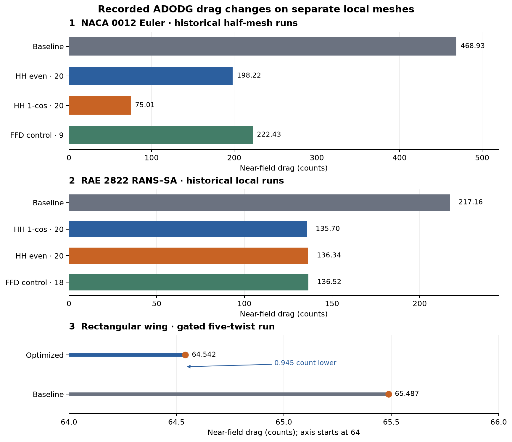

# ADODG benchmark study: three cases

The three Aerodynamic Design Optimisation Discussion Group (ADODG) cases provide benchmark evidence that the optimization workflow produced recorded drag reductions. Case 3 also passed mesh admission and a cold finite-difference derivative gate. The record does not establish grid-independent or experimentally validated absolute drag for any case. Case 1 and Case 2 run outputs are historical records; their raw directories are outside this release.

The benchmark is [Yang and Da Ronch, *Aerodynamic Shape Optimisation of Benchmark Problems Using SU2* (2018)](https://doi.org/10.2514/6.2018-0412). Their structured grids and continuous adjoint differ from this project's unstructured meshes and discrete-adjoint OpenMDAO/MPhys workflow. Values read from paper figures are approximate context, not exact regression targets.

*Figure 1.* Recorded local endpoints, with a separate baseline and scale for each case. The Case 1 full-mesh FFD-thickness run appears only in the table because it uses another baseline. The bars show within-case changes, not a ranking across different flows.

## Case 1: transonic NACA 0012 airfoil

At Mach 0.85 and zero angle, the Euler study reduces drag while retaining baseline thickness. The [case definition](../cases/adodg1_naca0012_euler_ffd/case.toml) and retained [1-cos Hicks–Henne](../cases/adodg1_naca0012_euler_ffd/input/configs/opt_hh_1cos_n20.toml), [even Hicks–Henne](../cases/adodg1_naca0012_euler_ffd/input/configs/opt_hh_even_n20.toml), [FFD control-point](../cases/adodg1_naca0012_euler_ffd/input/configs/opt_ffd_cp.toml), and [FFD thickness](../cases/adodg1_naca0012_euler_ffd/input/configs/opt_ffd_thickness.toml) files give the current runnable forms.

| Historical local run | Baseline | Final drag | Reduction | Recorded outcome |
| --- | ---: | ---: | ---: | --- |
| Even Hicks–Henne, 20 variables | 468.93 counts, half mesh | 198.22 counts | 57.7% | SLSQP success, 24 major iterations |
| 1-cos Hicks–Henne, 20 variables | 468.93 counts, half mesh | 75.01 counts | 84.0% | SLSQP success, 40 major iterations |
| FFD control points, 9 variables | 468.93 counts, half mesh | 222.43 counts | 52.6% | SLSQP success, 15 major iterations |
| FFD thickness, 9 variables | 454.45 counts, full mesh | 298.11 counts | 34.4% | Separate full-mesh baseline |

The half-mesh baseline lies within the paper's approximately 468–469-count medium-grid range. The local even-family endpoint is near the paper's approximately 205-count 20-variable point, read from a figure to about five counts. The local 1-cos endpoint is about 25 counts lower than the paper's approximately 100-count point. The paper documents mesh-dependent, non-unique optimized branches, so the latter difference cannot be assigned a scalar pass or failure. Both studies show strong drag reduction and an altered transonic shock pattern.

The retained half mesh has no complete admission record or local grid-error estimate. No Case 1 finite-difference TOML checks these shape rows.

## Case 2: transonic RAE 2822 airfoil

At Mach 0.734 and Reynolds number 6.5 million, the RANS–SA problem minimizes drag at lift 0.824 with a moment bound and retained area. The [case definition](../cases/adodg2_rae2822_rans_sa_ffd/case.toml) and retained [1-cos](../cases/adodg2_rae2822_rans_sa_ffd/input/configs/opt_hh_1cos_n20.toml), [even](../cases/adodg2_rae2822_rans_sa_ffd/input/configs/opt_hh_even_n20.toml), and [FFD](../cases/adodg2_rae2822_rans_sa_ffd/input/configs/opt_ffd_cp.toml) files select a 65,458-point, 85,330-cell unstructured mesh. The historical summary reports those counts, although no stored hash proves file identity.

| Historical local run | Baseline drag | Final drag | Reduction | Final constraints |
| --- | ---: | ---: | ---: | --- |
| 1-cos Hicks–Henne, 20 variables | 217.16 counts | 135.70 counts | 37.5% | Lift 0.8240, moment and area passed |
| Even Hicks–Henne, 20 variables | 217.16 counts | 136.34 counts | 37.2% | Lift 0.8240, moment and area passed |
| FFD control points, 18 variables | 217.16 counts | 136.52 counts | 37.1% | Lift 0.8240, moment and area passed |

The paper reports about 38% drag reduction across structured-grid comparisons. The three retained local parameterizations cluster at 37.1–37.5%, with similar aft-shifted, weakened-shock patterns in the historical pressure and Mach plots. The local absolute baseline drag is below the paper's 228.81–241.24-count grid range, so the reduction trend is the defensible comparison. A removed historical 30-variable 1-cos endpoint missed lift by 0.54%; it is not counted as feasible here.

The selected mesh has no recorded admission gate or grid-error estimate, and no Case 2 finite-difference TOML is shipped. Historical optimizer summaries cannot certify derivative or physical drag accuracy in this checkout.

## Case 3: subsonic rectangular wing

The [wing case](../cases/adodg3_naca0012_euler_ffd/case.toml) uses Euler flow at Mach 0.5 and lift 0.375. The [five-twist optimization](../cases/adodg3_naca0012_euler_ffd/input/configs/opt_ffd_twist_n5.toml) selects the exact-leading-edge mesh, five trailing-edge twist variables within ±4 degrees, a fixed trim angle of 4.263906770 degrees, and SLSQP. The admitted mesh has 1,283,195 tetrahedra.

| Check | Recorded result | Scope |
| --- | --- | --- |
| Mesh | Structural and quality admission passed | One exact-leading-edge mesh; no local grid uncertainty |
| Derivatives | Cold finite differences passed 12 of 12 twist and angle rows at 60 ranks | Twist band 10⁻³; angle band 10⁻⁴; other geometry rows untested |
| Optimization | SLSQP succeeded after 13 major iterations and 14 calls at 64 ranks; no failed call | Accepted primals and adjoints reached the configured −12 residual floor |
| Lift | Final lift 0.37499997; largest call deviation from 0.375 was 0.000009 | Recorded lift constraint passed |

Near-field drag fell from 65.487 to 64.542 counts, a 0.945-count or 1.44% reduction. Span efficiency \(e_0\) rose from 0.9360 to 0.9472, or 1.20%. The paper's five-variable wing shows about 0.9 count of drag reduction and about 1.26% efficiency improvement, read from figures and text. Local twist moved positive inboard and negative outboard, matching the published direction. These compare changes, not absolute coefficients.

The separate Trefftz induced-drag estimate fell by 1.06–1.45 counts over modal orders 5–15. The near-field reduction has the same sign and is 65–89% of that estimate. The near-field reduction lies 0.12 count outside the modal range, with no acceptance band for that gap. The near-field minus Trefftz offset changed by 0.41 count.

The scheme reports −14.22 counts of zero-lift drag and roughly 11 counts of near-field versus Trefftz offset at the trimmed designs. Those offsets prevent an absolute-drag validation claim. A grid-refinement study of the drag change remains open.

## What the evidence establishes

| Evidence | Case 1 | Case 2 | Case 3 |
| --- | --- | --- | --- |
| Runnable current configuration | Retained 20-variable HH and FFD files | Retained 20-variable HH and FFD files | Trim, derivative, and five-twist files |
| Historical benchmark comparison | Baseline and drag-reduction trends | Drag-reduction and shock-pattern trends | Drag change, efficiency, and twist direction |
| Mesh admission | Incomplete for historical half mesh | No recorded gate for selected remesh | Passed for exact-leading-edge mesh |
| Cold finite-difference gate | None for these shape rows | None for this mesh | 12/12 tested rows passed |
| Grid uncertainty and absolute physical validation | Not established | Not established | Not established |

These comparisons support using the three configurations as benchmark workflows. A new run needs its own mesh, residual, derivative, and final-constraint checks. Physical validation would also require a numerical-error bound from grid refinement and independent data with stated uncertainty.

**Sources.** The benchmark is Yang and Da Ronch (2018), [DOI 10.2514/6.2018-0412](https://doi.org/10.2514/6.2018-0412), especially Figs. 6, 14, 26, and 30–33. Case 1 and Case 2 values were transcribed from the project's archived ADODG study and run summaries. Those raw runs are not bundled.

Case 3 conditions and gates come from the recorded five-twist run and selected TOMLs. The [reference manual](llm-guides/reference_manual.md) states current case and derivative limits. No published paper figures are copied here.
